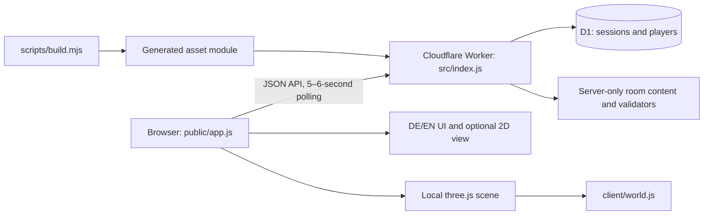
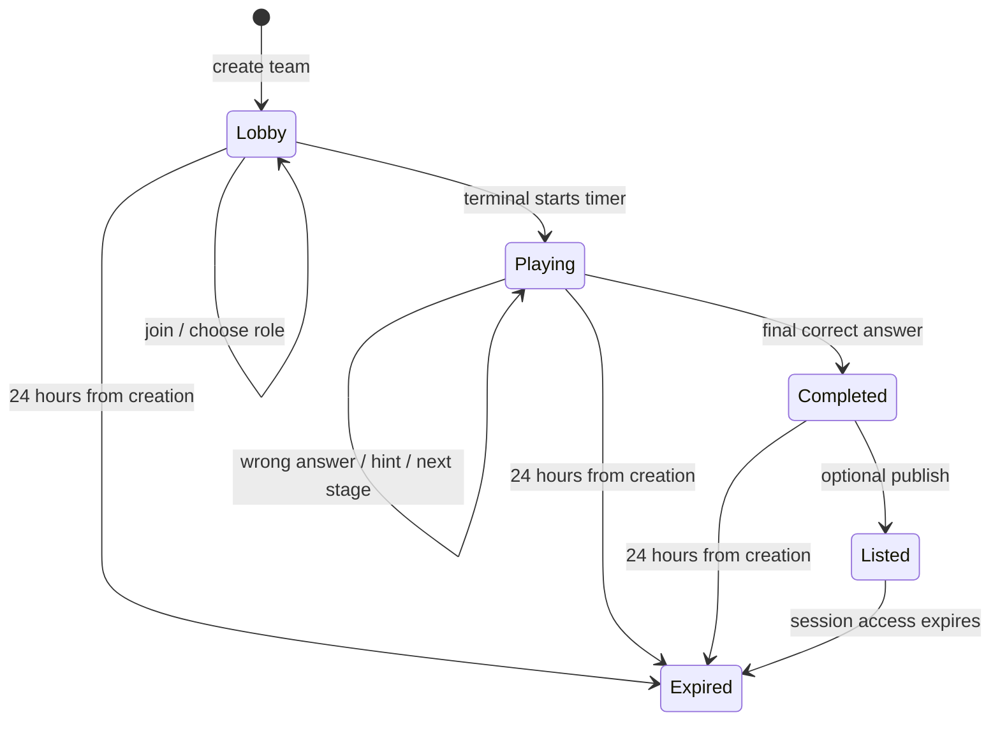

# Architecture

This describes the shipped 0.3.0 prototype. Proposed multi-mission infrastructure is in the [roadmap](roadmap.md).

## Components and build

`npm run build` first bundles `client/voxel-room.js` and three.js with esbuild. It then reads supported files directly inside `public/` and emits `src/generated/assets.js`, including a virtual `/voxel-room.js` asset. That generated bundle is imported by the Worker; there is no separate static hosting deployment or runtime CDN.

The build currently reads a **flat public directory**, accepts `.html`, `.js`, `.css`, `.svg`, and `.webmanifest`, and treats content as UTF-8 text. It does not recursively import directories or support binary textures/GLB files. The generated module, Wrangler output, and generated runtime types are ignored by Git. Future larger landscapes will need a revised asset pipeline rather than putting arbitrary files into `public/`.

## File ownership

| File / directory | Responsibility |
| --- | --- |
| `public/index.html`, `public/style.css` | Page structure and responsive styling |
| `public/app.js` | Team flow, forms, polling, role switching and scene integration |
| `public/event-config.js` | Shared public participant/team defaults, location values/labels and polling interval |
| `public/i18n.js` | UI dictionary and per-browser language preference |
| `public/sw.js`, `public/manifest.webmanifest` | PWA shell caching and installation metadata |
| `client/voxel-room.js` | Geometry, rendering, labels, input, nearby station detection and disposal |
| `client/world.js` | Spawn, obstacle footprints, walkable bounds and movement collision |
| `src/index.js` | HTTP/security headers, assets, API, auth tokens, SQL and scoring |
| `src/rooms/prompt-lab.js` | German canonical content, validators, role projection and MILO-message translation |
| `src/rooms/prompt-lab.en.js` | English mission text with matching option IDs |
| `src/errors.en.js` | English mapping for canonical server errors |
| `migrations/0001_sessions.sql` | Initial relational schema and indexes |
| `scripts/dev-server.mjs` | In-memory Node/SQLite QA adapter for the production handler |
| `tests/game.test.mjs` | SQLite integration tests plus language and collision checks |

The compact current UI and world builder are shared editing hotspots. Coordinate refactors in issues; avoid broad formatting changes in a content PR.

## Session lifecycle

Creation returns a team code and an individual random player token. The browser stores that token in session storage; the database stores only its SHA-256 hash. A code admits a teammate with a new token. It is a lightweight capability-based game session, not an account/login system.

`sessions.stage` is a zero-based cursor. `started_at` is set once by a terminal. A correct answer increments the cursor, resets the current hint level, and writes MILO's success text. A wrong answer adds a mistake without advancing. The final answer sets `finished_at`. Dates are epoch milliseconds; the timer uses the server's timestamps and clock offset.

Progress-changing gameplay writes use `WHERE code = ? AND revision = ?` and increment `revision`. A stale or concurrent submission returns 409 instead of advancing twice. Role changes update a player row; leaderboard publishing is a separate completed-session action and does not use the gameplay revision guard. Do not assume every POST requires the same revision semantics.

The browser polls every 5–6 seconds (a 5-second base plus per-browser random offset) when visible and not busy. Its action epoch prevents an older poll response overwriting a newer action or language switch. Draft form values and the existing scene instance are retained when appropriate. The server remains authoritative for completion and scoring.

## Data model

| Table | Important fields |
| --- | --- |
| `sessions` | `code`, `team`, `location`, `room`, `stage`, `revision`, `hints`, `hint_level`, `mistakes`, `created_at`, `started_at`, `finished_at`, `last_message`, `listed` |
| `players` | `token_hash`, `session_code`, `role`, `created_at` |

`players.session_code` references `sessions.code` with cascading deletion. The `room` column exists, but the handler currently imports one fixed room and does not select content from that field. There is no objective graph, mission version, inventory, avatar position, account, or campaign-progress table.

The leaderboard score is elapsed whole seconds + 60 per hint + 15 per mistake. Role switches and multiple terminals are allowed; scores are suitable for a friendly prototype rather than a verified competition.

## Roles, languages and information boundaries

`stageView(stage, role, hintLevel, locale)` serializes only the appropriate content. A terminal gets the task and choices/slots; a handbook gets source notes. Both see already-unlocked hints. Validator functions stay on the server. Manual roles cannot submit gameplay answers.

Each request carries `X-Game-Language: de` or `en`; absent/unsupported values use German. Session data and answer IDs remain language independent. Canonical MILO messages are currently stored as German text and mapped to English on read. Changing those canonical strings can affect existing sessions; future content versions should use stable message IDs.

## Scene and state boundaries

The scene receives `t`, `onInteract`, `unlocked`, and an optional position snapshot. Its controller exposes `update()`, `pause()`, `snapshot()`, and `dispose()`. The scene reports a station ID; `interactStation()` in the app decides which panel or message to show. Moving through the exit never submits an answer or completes a mission by itself.

Camera movement is local to one browser. Puzzle progress and the unlocked door state are shared through the API. Scene resources, observers, input listeners, textures and animation frames are cleaned up when a view is disposed. Paused or invisible views avoid unnecessary rendering.

## Runtime and privacy boundaries

The Worker uses D1 bindings, prepared statements, bounded JSON input, same-origin checks, security headers and configured rate-limit bindings. Tokens and codes must not be included in screenshots or ordinary logs. The local QA adapter does not enforce the platform rate-limit bindings.

The service worker uses a network-first cache for selected shell assets. API responses are `no-store`; offline mutation replay is not implemented. Cached query URLs and updates need deliberate testing when the asset pipeline changes. Retention and operational details are in [operations](operations.md).
